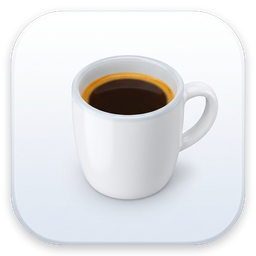

<div align="center">
  
  <h1>AlwaysOn (Rust)</h1>
</div>

A lightweight, native Windows 11 utility built in pure Rust + Win32 APIs to **keep your PC and display awake** without heavy runtime frameworks.

If you are downloading large files, rendering builds/videos, or reading without touching your keyboard and mouse, **AlwaysOn** sits quietly in the system tray and prevents sleep with minimal memory and zero idle CPU overhead.

## Features
- **WinUI 3 Fluent Control Panel**: Native bottom-right flyout built directly with Win32 + DWM `Mica Alt`, `Segoe UI Variable` typography, `Segoe Fluent Icons`, SDF anti-aliased `SettingsCard` surfaces, and `#4CC2FF` `SelectorBar` / `ToggleSwitch` controls.
- **Event-Driven 60fps Animations**: Smooth flyout entrance slide, stretching toggle switch thumbs, sliding `SelectorBar` indicator pills, and horizontal view navigation transitions—automatically stopping the animation timer when idle so CPU stays at `0%`.
- **Ultra-Low Resource Footprint**: Reuses cached GDI fonts and DIB surfaces during interaction, releases all paint buffers and trims process working set (`SetProcessWorkingSetSize`) when minimized to the tray, and suspends heartbeat timers when sleep prevention is off.
- **Flexible Modes & Display Control**: Choose between **Indefinite (Süresiz)**, **30 Minutes**, **1 Hour**, or **3 Hours**, plus toggle whether to keep the display powered or only prevent system sleep (`SetThreadExecutionState`).
- **Dedicated Settings View (`⚙`)**: Toggle **Run at Windows startup**, choose **Close button (`✕`) behavior** between **Minimize to Tray** (`Alta Al (Tepsi)`) or **Exit Application** (`Uygulamayı Kapat`), and switch **App Language** between **System** (`Sistem`), **Türkçe**, and **English**, persisted under `HKCU\Software\AlwaysOn`.
- **Reliable Autostart & Tray Integration**: Installs cleanly to `%LOCALAPPDATA%\Programs\AlwaysOn\AlwaysOn.exe`, repairs shortcut/registry paths, recovers gracefully on `TaskbarCreated`, and guards single-instance execution per desktop.
- **Dynamic Localization**: Defaults to the Windows display language (`Sistem` / `System`) and lets you override the UI, window title, tray tooltip, context menu, and notifications on the fly to Turkish or English.

## Building & Testing
Run unit/scenario tests and build the release executable:
```bash
cargo test --release
cargo build --release
```
